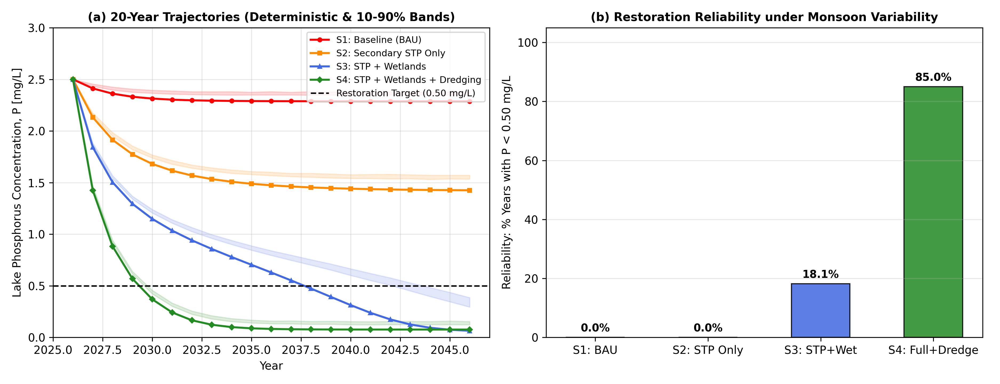
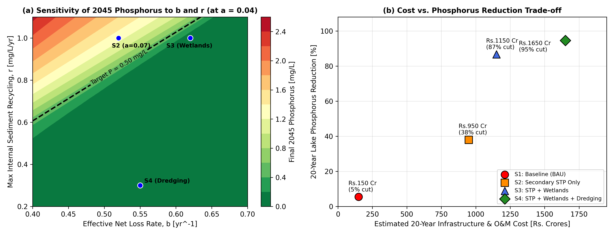
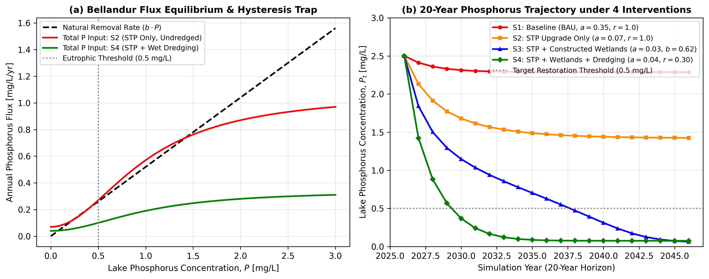

# CE 766: Watershed Management — Bellandur Lake Restoration Model
**Student:** Sharath Kumar MD | **Course Instructor:** Prof. Riddhi Singh (IIT Bombay)

## 1. Overview
This repository contains the physical parameterization and Python simulation code adapted from the Carpenter et al. (1999) shallow-lake framework to model phosphorus dynamics and evaluate four restoration interventions for **Bellandur Lake, Bengaluru** over a 20-year horizon (2026–2045) under stochastic urban stormwater phosphorus surges and parameter uncertainty.

## 2. Final Results
### Figure 1: 20-Year Trajectories & Restoration Reliability (100 Stochastic Realizations)

*Figure 1: (a) Deterministic trajectories and 10th–90th percentile stochastic bands across 100 stormwater surge realizations; (b) Restoration reliability (% of simulated lake-years meeting P < 0.50 mg/L).*

### Figure 2: Parameter Sensitivity (b vs. r) & 20-Year Cost Trade-off

*Figure 2: (a) Sensitivity of final 2045 phosphorus concentration to uncertainties in effective removal (b) and internal sediment recycling (r); (b) Estimated 20-year infrastructure cost versus median phosphorus reduction.*

## 3. Preliminary Results

*Preliminary Figure: (a) Annual phosphorus flux balance showing steady-state equilibrium intersections between natural removal and total inputs; (b) Deterministic 20-year phosphorus concentration trajectories (2026–2045) under four management interventions.*

## 4. Repository Contents
* `bellandur_final_simulation.py`: Final Python script reading `baseline_parameters.csv` to run deterministic and 100-member Monte Carlo simulations, sensitivity analysis, and cost-reduction trade-offs.
* `baseline_parameters.csv`: Compiled hydrological, bathymetric, and nutrient baseline parameters.
* `Figure1_Stochastic_Trajectories.png`: Final trajectory and reliability figure.
* `Figure2_Sensitivity_Cost_Tradeoff.png`: Final parameter sensitivity and cost trade-off figure.
* `lake_model.py`: Preliminary deterministic simulation script.
* `ce766_2.png`: Preliminary equilibrium and trajectory figure.

## 5. Evaluated Management Interventions
1. **S1: Business-as-Usual (BAU, Rs. 150 Cr):** Baseline partial STP treatment continues ($a = 0.35\text{ mg/L/yr}$, $b = 0.52\text{ yr}^{-1}$, $r = 1.00\text{ mg/L/yr}$, undredged). Trapped at $2.29\text{ mg/L}$ ($0.0\%$ reliability)[cite: 21].
2. **S2: Secondary STP Upgrade Only (Rs. 950 Cr):** 80% external sewage load cut ($a = 0.07\text{ mg/L/yr}$, $b = 0.52\text{ yr}^{-1}$), undredged bed ($r = 1.00\text{ mg/L/yr}$). Trapped at an upper equilibrium of $1.43\text{ mg/L}$ due to internal legacy recycling ($0.0\%$ reliability)[cite: 21].
3. **S3: STP + Constructed Wetlands (Rs. 1,150 Cr):** >90% external load cut ($a = 0.03\text{ mg/L/yr}$) paired with improved aeration and flushing ($b = 0.62\text{ yr}^{-1}$, $r = 1.00\text{ mg/L/yr}$). Crosses $0.50\text{ mg/L}$ around year 12 deterministically, achieving $18.1\%$ reliability under stochastic stormwater surges[cite: 21].
4. **S4: Comprehensive Restoration — STP + Wetlands + Wet Dredging (Rs. 1,650 Cr):** External load reduction ($a = 0.04\text{ mg/L/yr}$, $b = 0.55\text{ yr}^{-1}$) combined with wet dredging of the $6.56\text{ MCM}$ anoxic slush bed ($r = 0.30\text{ mg/L/yr}$). Restores water quality below $0.50\text{ mg/L}$ within 3.5 years (by 2030) and achieves $85.0\%$ reliability[cite: 21].

## 6. Data Sources & References
1. **Hydrological, Bathymetric & Slush Parameters:**  
   Ramachandra, T. V., Vinay, S., Mahapatra, D. M., Varghese, S., & Aithal, B. H. (2017). *Bellandur and Varthur Lakes Rejuvenation Blueprint*. ENVIS Technical Report 116, Energy & Wetlands Research Group, Centre for Ecological Sciences, Indian Institute of Science (IISc), Bengaluru. [OpenCity Mirror / Report PDF](https://data.opencity.in/dataset/7db14eaa-eab8-4c53-bf76-dd87e0596ef0/resource/15697f42-da4e-4080-80cd-57242a9db4f8/download/5bf60873-1620-4a4a-a3f7-9bcee34d40f2.pdf)
2. **Water Quality Records:**  
   Karnataka State Pollution Control Board (KSPCB). *Real-Time Continuous Lake Water Quality Monitoring Network (Bellandur & Varthur)*. [KSPCB Monitoring Portal](https://tpro.telsys.in/tpportal/kspcblake)
3. **Model Foundation:**  
   Carpenter, S. R., Ludwig, D., & Brock, W. A. (1999). Management of eutrophication for lakes subject to potentially irreversible change. *Ecological Applications*, 9(3), 751–771[cite: 5, 9].
