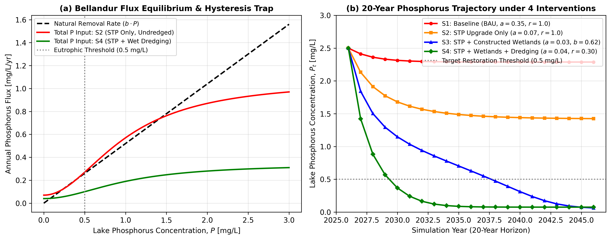

# CE 766: Watershed Management — Bellandur Lake Eutrophication Model
**Course Instructor:** Prof. Riddhi Singh (IIT Bombay)

## 1. Overview
This repository contains the physical parameterization and Python simulation code adapted from the Carpenter et al. (1999) shallow-lake framework to model phosphorus dynamics and evaluate four restoration interventions for **Bellandur Lake, Bengaluru** over a 20-year horizon (2026–2045).

## 2. Preliminary Results

*Figure 1: (a) Annual phosphorus flux balance showing steady-state equilibrium intersections between natural removal and total inputs; (b) 20-year phosphorus concentration trajectories (2026–2045) for Bellandur Lake under four management interventions.*

## 3. Repository Contents
* `lake_model.py`: Python simulation script executing the discrete annual mass-balance model and generating the scenario plots.
* `ce766_2.png`: Two-panel result figure showing the phase-plane equilibrium/hysteresis trap and 20-year concentration trajectories.

## 4. Evaluated Management Interventions
1. **S1: Business-as-Usual (BAU):** Baseline partial STP treatment continues ($a = 0.35\text{ mg/L/yr}$, $b = 0.52\text{ yr}^{-1}$, $r = 1.0\text{ mg/L/yr}$, undredged). Trapped at $2.29\text{ mg/L}$.
2. **S2: Secondary STP Upgrade Only:** 80% external sewage load cut ($a = 0.07\text{ mg/L/yr}$, $b = 0.52\text{ yr}^{-1}$), but undredged bed ($r = 1.0\text{ mg/L/yr}$). Trapped at an upper equilibrium of $1.43\text{ mg/L}$ due to internal legacy recycling (hysteresis trap).
3. **S3: STP + Constructed Wetlands:** 90% external load cut ($a = 0.03\text{ mg/L/yr}$) paired with improved aeration and flushing ($b = 0.62\text{ yr}^{-1}$). Recovers below $0.50\text{ mg/L}$ after 12 years (by 2038).
4. **S4: Comprehensive Restoration (STP + Wetlands + Wet Dredging):** External load reduction ($a = 0.04\text{ mg/L/yr}$, $b = 0.55\text{ yr}^{-1}$) combined with wet dredging of the $6.56\text{ MCM}$ anoxic slush bed ($r = 0.30\text{ mg/L/yr}$). Restores water quality below $0.50\text{ mg/L}$ within 3.5 years (by 2030) and stabilizes at $0.08\text{ mg/L}$.

## 5. Data Sources & References
1. **Hydrological, Bathymetric & Slush Parameters:**  
   Ramachandra, T. V., Vinay, S., Mahapatra, D. M., Varghese, S., & Aithal, B. H. (2017). *Bellandur and Varthur Lakes Rejuvenation Blueprint*. ENVIS Technical Report 116, Energy & Wetlands Research Group, Centre for Ecological Sciences, Indian Institute of Science (IISc), Bengaluru. [OpenCity Mirror / Report PDF](https://data.opencity.in/dataset/7db14eaa-eab8-4c53-bf76-dd87e0596ef0/resource/15697f42-da4e-4080-80cd-57242a9db4f8/download/5bf60873-1620-4a4a-a3f7-9bcee34d40f2.pdf)
2. **Water Quality Records:**  
   Karnataka State Pollution Control Board (KSPCB). *Real-Time Continuous Lake Water Quality Monitoring Network (Bellandur & Varthur)*. [KSPCB Monitoring Portal](https://tpro.telsys.in/tpportal/kspcblake)
3. **Model Foundation:**  
   Carpenter, S. R., Ludwig, D., & Brock, W. A. (1999). Management of eutrophication for lakes subject to potentially irreversible change. *Ecological Applications*, 9(3), 751–771.
